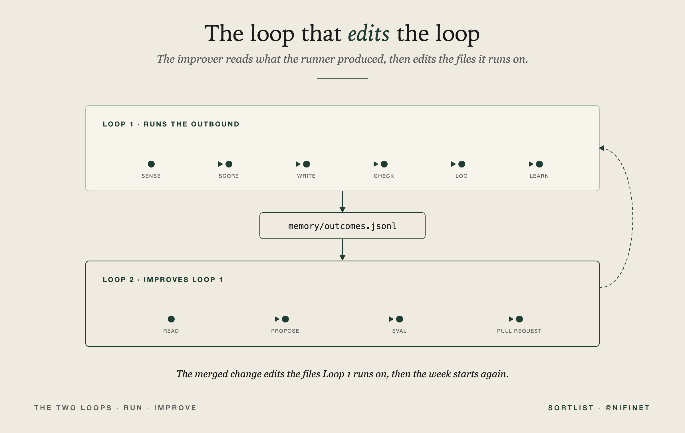
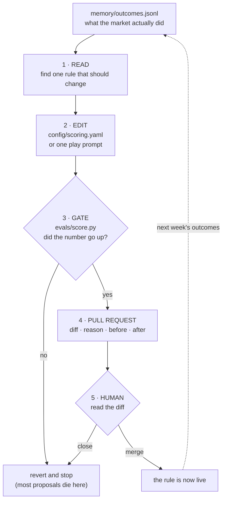
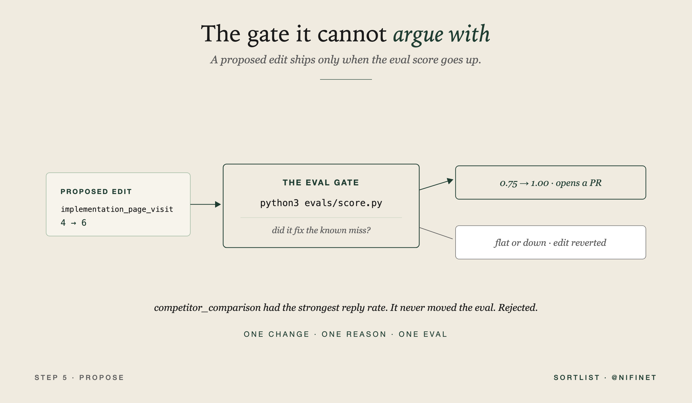

<div align="center">

# codex-self-improving-outbound

### GTM as versioned code that improves from the market. Codex reads last week's outcomes, edits the files your outbound runs on, proves the change against a test, and opens a pull request. You merge it, or you do not.


**Runs on the ChatGPT/Codex plan you already pay for. The offline demo needs nothing at all.**
**The managed version is [max](https://yourmax.ai).**

</div>

---

Earlier this year Andrej Karpathy pointed an agent at his own training code and let it run for two days. It ran 700 experiments, kept the 20 that beat the benchmark, and made the model train 11% faster. Then he said the thing worth stealing: any metric you can evaluate cheaply can be handed to an agent swarm.

Reply rate is a metric you can evaluate cheaply.

Most people have now built the first loop: sense the market, score the account, write from the signal, check the message, log the outcome, learn from the reply. This repo is the **second loop**, the one that edits the first.

```
The runner produces outcomes.
The improver edits the files the runner uses.
The human merges.
```

Sending stays outside the loop. Merging stays outside the loop. Everything in between is automated.



The full write-up is in [article.md](article.md).

## Contents

1. [How it works](#how-it-works)
2. [Prerequisites](#prerequisites)
3. [Clone and run, step by step](#clone-and-run-step-by-step)
4. [The repo](#the-repo)
5. [Command reference](#command-reference)
6. [The eight steps, and where each one breaks](#the-eight-steps-and-where-each-one-breaks)
7. [Putting it on a cadence](#putting-it-on-a-cadence)
8. [Safety](#safety)
9. [Troubleshooting](#troubleshooting)
10. [Free vs max](#free-vs-max)
11. [Who built this](#who-built-this)

---

## How it works



| Layer | File | What it does |
|---|---|---|
| **The law** | `AGENTS.md` | What Codex is allowed to touch. Read before every run. |
| **The judgment** | `config/scoring.yaml` | Which signals matter and by how much. A file, not a function. |
| **The copy** | `config/plays.yaml`, `prompts/plays/*.md` | What each message says. Improves in its own lane. |
| **The memory** | `memory/outcomes.jsonl` | One line per touch, written when the outcome lands. |
| **The gate** | `evals/score.py`, `evals/fixtures.yaml` | One command, one number. Nothing ships if it does not go up. |
| **The improver** | `prompts/improve_scoring.md`, `prompts/improve_prompt.md` | The job handed to Codex. |
| **The control layer** | `scripts/open_pr.sh` | Codex proposes. A human merges. |

---

## Prerequisites

| | What | Check |
|---|---|---|
| 1 | **Python 3.10 or newer** | `python3 --version` |
| 2 | **git** | `git --version` |
| 3 | **Codex** (optional for the demo) | `npm install -g @openai/codex && codex login`. Uses your ChatGPT plan. No OpenAI API key. |

Steps 1 to 4 below need nothing but Python.

---

## Clone and run, step by step

### Step 1 - Get the code

```bash
git clone https://github.com/nifinet/codex-self-improving-outbound.git
cd codex-self-improving-outbound
```

Or unzip the folder you were sent and `cd` into it.

### Step 2 - Create a virtual environment

```bash
python3 -m venv .venv
source .venv/bin/activate      # Windows: .venv\Scripts\activate
pip install -r requirements.txt
```

> One dependency, `pyyaml`. If you skip this entirely the repo still runs on a built-in fallback parser.

### Step 3 - Run the gate

```bash
python3 evals/score.py
```

```text
Northwind Finance: predicted=human_review expected=human_review (score 12)
Bluepeak Studio: predicted=ignore expected=ignore (score 1)
KiteOps: predicted=ignore expected=draft (score 4)   <- MISS
Atlas Recruiting: predicted=ignore expected=ignore (score -3)
score=0.75
```

> **This repo ships broken on purpose.** `implementation_page_visit` is set to 4, which routes an account the fixture says deserves a message straight to `ignore`. That is the known miss. Do not fix it by hand.

### Step 4 - Let the improver find it

```bash
python3 scripts/propose_improvement.py
```

```text
score=0.75
changed config/scoring.yaml
implementation_page_visit: 4 -> 6
score=1.00
open PR for human review
```

Look at what it tried first, in `outputs/proposal.json`:

```text
competitor_comparison: 8 -> 9   left score at 0.75
competitor_comparison: 8 -> 10  left score at 0.75
competitor_comparison: 8 -> 11  left score at 0.75
competitor_comparison: 8 -> 12  left score at 0.75
implementation_page_visit: 4 -> 5  left score at 0.75
```

> This is the whole point. `competitor_comparison` is the cleanest-looking signal in the log: every single touch replied or booked. A system without a gate would have raised it, written a confident paragraph about why, and been useless. The gate asked a better question: **did the change fix the known miss?** It did not, so it was reverted. Five proposals died before one earned a PR.



### Step 5 - Hand the same job to Codex

```bash
npm install -g @openai/codex
codex login
scripts/run_codex_step.sh improve_scoring
```

Codex reads `AGENTS.md`, then does what step 4 did, except it can also read the `reason` field and reason about the copy. Same law, same gate, same revert rule.

> **The sandbox flag is not optional.** Codex defaults to a read-only sandbox, so a step that needs to edit `config/scoring.yaml` will run, print something reasonable, and change nothing. `run_codex_step.sh` always passes `--sandbox workspace-write`. If you call Codex by hand, pass it yourself. See [docs/CODEX.md](docs/CODEX.md).

If you would rather build the pieces yourself instead of cloning them, every build prompt from the article is in [prompts/build-prompts.md](prompts/build-prompts.md).

### Step 6 - Make it yours

Three files, all plain text.

- `config/scoring.yaml` - your signals and weights.
- `evals/fixtures.yaml` - the accounts you wish the system had routed differently.
- `memory/outcomes.jsonl` - replace the sample with your own touches.

Write outcomes as they land, never in a Friday backfill:

```bash
python3 scripts/append_outcome.py \
  --date 2026-07-11 --account "KiteOps" \
  --signal implementation_page_visit --play implementation_angle \
  --score 6 --outcome reply \
  --reason "asked about implementation timeline"
```

It rejects missing fields, unknown outcomes, empty reasons, and dates in the future.

### Step 7 - Run the tests

```bash
python3 -m tests.test_repo
```

> 23 checks, pure standard library. Covers the baseline miss, the negative-signal cancel, the validator, and the revert path.

### Step 8 - Put it on a cadence

See [below](#putting-it-on-a-cadence). Run two tune-ups by hand first.

---

## The repo

```text
codex-self-improving-outbound/
  AGENTS.md                      the law Codex reads before it touches anything
  article.md                     the full write-up this repo accompanies
  config/
    scoring.yaml                 which signals matter (ships in its BEFORE state)
    plays.yaml                   which play answers which signal
  prompts/
    improve_scoring.md           the scoring lane
    improve_prompt.md            the copy lane
    pr_summary.md                how to explain a change to a human
    build-prompts.md             every build prompt from the article
    plays/
      migration_note.md
      implementation_angle.md
  memory/
    outcomes.jsonl               what the market did
  evals/
    fixtures.yaml                the cases that must keep passing
    score.py                     the gate
    _minimal_yaml.py             fallback parser, so the demo runs with no deps
  scripts/
    append_outcome.py            the validator, build this first
    propose_improvement.py       the improver, offline, no key
    run_codex_step.sh            the improver, on Codex
    create_pr.py                 writes the PR body
    open_pr.sh                   opens the PR, never merges
    weekly_tune.sh               the Monday run
  docs/
    CODEX.md                     running it on your ChatGPT plan
    SAFETY.md                    what it refuses to do, and why
    TROUBLESHOOTING.md
  examples/
    outcomes.sample.jsonl
    sample-run.md                what a first clone actually prints
    weekly-pr.md                 what a good PR looks like
  tests/
    test_repo.py
```

---

## Command reference

| Command | What it does |
|---|---|
| `python3 evals/score.py` | Run the gate. Exits nonzero below 1.00, so CI can block a bad change. |
| `python3 scripts/propose_improvement.py` | Propose one weight change, offline, no key. Reverts if the gate does not move. |
| `python3 scripts/propose_improvement.py --dry-run` | Same, but never writes to `config/scoring.yaml`. |
| `python3 scripts/append_outcome.py ...` | Append a validated outcome row. |
| `scripts/run_codex_step.sh improve_scoring` | Hand the scoring lane to Codex. |
| `scripts/run_codex_step.sh improve_prompt` | Hand the copy lane to Codex. |
| `scripts/weekly_tune.sh` | The full Monday run: gate, propose, gate, summary, PR. |
| `python3 -m tests.test_repo` | 23 checks, no dependencies. |
| `make help` | The same commands, if you prefer make. |

Set `CODEX_MODEL` to change the model: `CODEX_MODEL=<model> scripts/run_codex_step.sh improve_scoring`.

---

## The eight steps, and where each one breaks

| Step | What good looks like | Where it breaks |
|---|---|---|
| **1. Write the law first** | You can read `AGENTS.md` before approving a PR and know exactly what Codex was allowed to do. | The law becomes a compliance document. If it needs a table of contents, it is already too large. |
| **2. Move judgment into config** | The file is small enough to argue with. Five signals is a good first version. | The scoring file becomes a junk drawer. Twenty signals and an exception for every edge case will make the improver overfit. |
| **3. Write outcomes as memory** | After a week, a stranger can read the file and tell which signals created replies and which internal favorite the market ignored. | The team backfills on Friday from memory. The wins survive, the bad-fit reasons blur, and the system learns from fiction. |
| **4. Build the eval gate** | One command gives one number, and every failed case is easy to inspect. | The fixture only holds obvious wins, so every reckless change passes. Put ugly cases in it. |
| **5. Propose one scoring change** | The diff is boring and traceable: one line, one outcome-backed reason, one eval improved. | Codex changes three weights and two prompts at once. Now nobody can tell which change helped. |
| **6. Improve prompts separately** | "This phrase appeared in seven no-reply outcomes, so I added it to banned_lines." | The improver rewrites the whole voice because one message got a reply. Prompt edits should be smaller than your instinct. |
| **7. Ship changes as pull requests** | One PR a week, small diff, clear reason, passing eval. | Someone gives Codex permission to merge because review feels like friction. That minute separates a system that improves from a system that drifts. |
| **8. Put it on a cadence** | A weekly PR appears with the evidence, the diff, and the eval result. | The job runs, nobody reviews, and PRs pile up. A self-improving system still has one human habit: read the diff. |

The `reason` field in `memory/outcomes.jsonl` is doing more work than it looks like. `no_reply` tells you almost nothing. `content-only intent` tells the next run that this signal might not deserve a draft. `asked about implementation timeline` is the kind of detail that can change a weight.

---

## Putting it on a cadence

Do not run this after every reply. That is how a system overfits to one loud account. Let the week happen, let outcomes accumulate, then tune.

```bash
scripts/weekly_tune.sh
```

Cron:

```bash
0 8 * * MON cd ~/codex-self-improving-outbound && scripts/weekly_tune.sh
```

GitHub Actions, same shape, in `.github/workflows/weekly-tune.yml`:

```yaml
on:
  schedule:
    - cron: "0 8 * * 1"
  workflow_dispatch:
```

> Run the first two tune-ups by hand. Read every diff. Watch what Codex tries to change when the sample is thin. Once the proposals are boring, put it on a schedule.

---

## Safety

The interesting property of this repo is what it refuses to do.

| | Guarantee | Enforced by |
|---|---|---|
| **Never sends** | There is no delivery code here at all. Nothing to misconfigure. | no delivery module exists |
| **Never self-merges** | Codex opens a PR. The merge button stays with a person. | `AGENTS.md`, `scripts/open_pr.sh` |
| **Never ships an unproven change** | A proposal that does not move the gate is reverted on disk. | `evals/score.py`, `scripts/propose_improvement.py` |
| **One concept per proposal** | You can always tell which change caused which result. | `AGENTS.md`, `MAX_DELTA` in the improver |
| **Never touches real people** | No scraping, no enrichment. The sample accounts are invented. | `AGENTS.md` |

Prove the improvement loop before you wire delivery. Not after.

---

## Troubleshooting

| Symptom | Fix |
|---|---|
| `score=0.75` on a fresh clone | Correct. That is the shipped state. Run `scripts/propose_improvement.py`. |
| `No single weight change improved the gate` | Also correct, once the gate is at 1.00. Add outcomes and a harder fixture case. |
| `codex not found` | `npm install -g @openai/codex && codex login`, or use `scripts/propose_improvement.py` instead. |
| `ModuleNotFoundError: yaml` | Harmless, the fallback parser takes over. `pip install -r requirements.txt` to silence it. |
| `open_pr.sh` says nothing to open | The improver reverted its change. Nothing was proven, so nothing ships. Working as intended. |
| PRs pile up unreviewed | Turn the cron off until the habit is back. An unread PR queue is worse than no automation. |

---

## Free vs max

This repo is the manual layer. Every rule is exposed, which is what makes it worth reading.

| | **This repo** (free, you run it) | **[max](https://yourmax.ai)** (managed) |
|---|---|---|
| **Improvement loop** | you run it weekly and read the diff | runs continuously |
| **Signals** | your own files and public sources | plus Sortlist buyer-side demand, the company searching for what you do this week |
| **Copy** | your plays, your prompts | drafted across email and LinkedIn for approval |
| **Approval** | a pull request | an approval queue |
| **Setup** | clone it, an afternoon | talk to an agent, it runs |

Buyer-side demand is the one input free can never give you, because it is not on the public web. If the free version is enough for you, use the free version.

---

## Who built this

[Nicolas Finet](https://be.linkedin.com/in/nifinet), co-founder and CEO of [Sortlist](https://www.sortlist.com). Four of us started Sortlist in Brussels in 2014; it now runs 4,000+ paying agencies. Sortlist owns [Overloop AI](https://overloop.com) and builds [max](https://yourmax.ai).

This is the second loop from [the article](https://x.com/nifinet). The first loop, the runner that senses and drafts, is [codex-outbound-engine](https://github.com/nifinet/codex-outbound-engine).

## Contributing

Found a weak fixture, a better improver heuristic, or a failure mode I missed? Open an issue or a PR. This gets sharper when the people running it push back on it.

## License

MIT. Clone it, fork it, make it yours.
