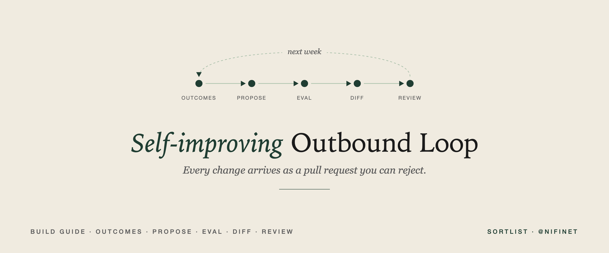
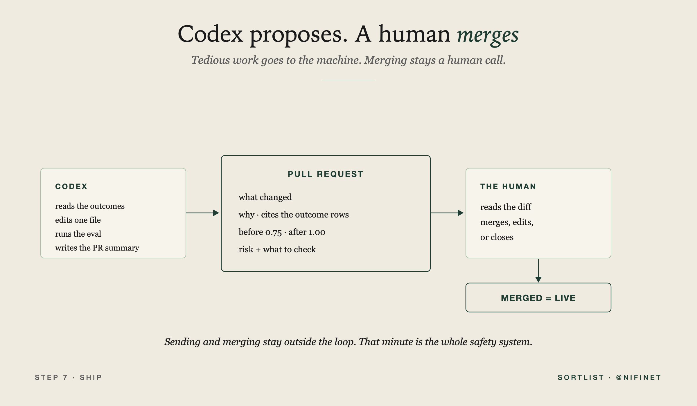
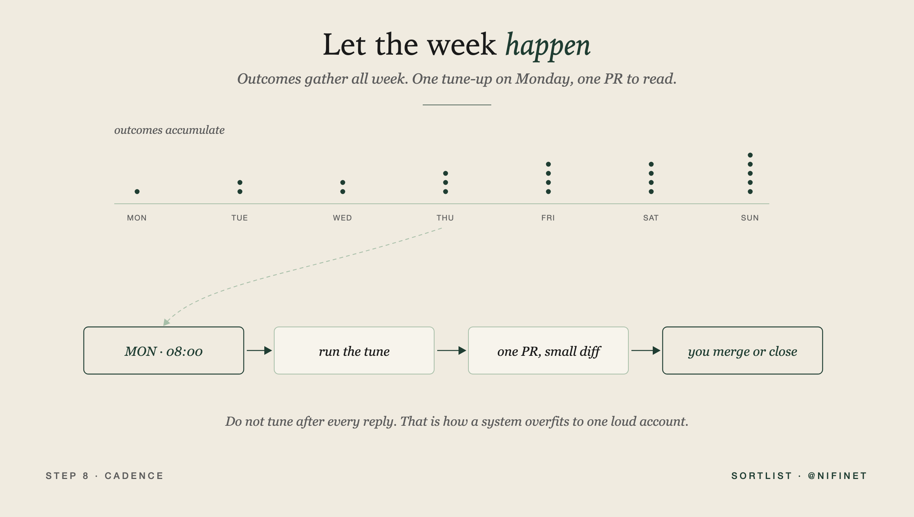

# How to Build a Self-Improving Outbound System on Codex

*By [Nicolas Finet](https://x.com/nifinet). This is the article this repo accompanies.*



Earlier this year, Andrej Karpathy (@karpathy) pointed an agent at his own training code and let it run for two days. It ran 700 experiments, kept the 20 that beat the benchmark, and made the model train 11% faster. Then he said something quite interesting: any metric you can evaluate cheaply can be handed to an agent swarm.

Reply rate is a metric you can evaluate cheaply. I have spent some time since working out what that loop looks like pointed at outbound.

My build:

Codex reads last week's outcomes, edits the scoring and play files the outbound system runs on, runs a test, and opens a pull request. It proposes a change to the playbook with the evidence and the score attached, then waits for a human to approve it. Sending and merging stay outside the loop.

I have built the first loop a few times: sense the market, score the account, write from the signal, check the message, log the outcome, learn from the reply. This article is about the second loop, the one that edits the first.

That is the build: GTM as versioned code that improves from the market.


## The repo

Start with the folder. The shape matters because Codex can only improve what it can read and edit.

```text
codex-self-improving-outbound/
  AGENTS.md
  README.md
  config/
    scoring.yaml
    plays.yaml
  prompts/
    improve_scoring.md
    improve_prompt.md
    pr_summary.md
  memory/
    outcomes.jsonl
  evals/
    fixtures.yaml
    score.py
  scripts/
    append_outcome.py
    run_codex_step.sh
    propose_improvement.py
    open_pr.sh
    weekly_tune.sh
  examples/
    outcomes.sample.jsonl
    weekly-pr.md
```

The repo is intentionally plain. `config/scoring.yaml` holds the rules that decide which signals matter. `prompts/` holds the plays that write the messages. `memory/outcomes.jsonl` holds what the market did. `evals/score.py` is the gate that says whether a proposed change helped. `AGENTS.md` is the law Codex reads before it touches anything.

Run the first version offline. No CRM, no enrichment, no delivery system. The improvement loop should prove itself on local files before it gets anywhere near a real outbound machine.

## Step 1. Write the law first

Before the scoring file, before the prompt files, write `AGENTS.md`. This is the file that keeps the agent useful and contained.

```markdown
# Self-Improving Outbound Rules

You improve an outbound system from outcomes.

Hard rules:
- Never send messages.
- Never scrape or enrich real people.
- Never self-merge.
- Edit only files in this repo.
- Change one concept at a time.
- Cite outcomes from memory/outcomes.jsonl for every proposed change.
- Improve evals/score.py before a change can become a PR.
- If the eval does not improve, revert your edit and stop.

Allowed edits:
- config/scoring.yaml
- config/plays.yaml
- prompts/*.md

Required output:
- changed files
- reason for each change
- before score
- after score
- pull request summary
```

The law has one job: narrow the work. Without it, Codex will try to help by expanding scope. It will add more data, touch more files, call more tools, or automate a step that should stay under human control. Here the job is smaller: read outcomes, propose one file change, prove it helped, then wait.

**What good looks like.** You can read the law before approving a PR and know exactly what Codex was allowed to do.

**Where it breaks.** The law becomes a compliance document. If `AGENTS.md` needs a table of contents, it is already too large. Keep it operational.

## Step 2. Move judgment into config

Most outbound judgment lives in someone's head. Then the team buys software and expects the software to improve a decision it cannot see.

Move the judgment into a file.

```yaml
signals:
  competitor_comparison:
    weight: 8
    reason: "buyer is comparing alternatives"
  implementation_page_visit:
    weight: 6
    reason: "buyer is checking whether this can be installed"
  job_repost:
    weight: 5
    reason: "role is still open and urgent"
  funding_event:
    weight: 5
    reason: "budget or mandate may have changed"
  generic_download:
    weight: 1
    reason: "content interest, weak buying intent"

thresholds:
  draft: 6
  human_review: 10

negative_signals:
  student_research: -8
  vendor_pitch: -6
  competitor: -10
```

This file starts as a visible hypothesis. If a generic download should count for zero, the team can point to the exact line and change it. If an implementation page visit is a stronger signal than you thought, Codex can propose the diff and show the outcome rows that justify it.

Do not bury this logic in a Python function. If the rule is visible, the team can review it, argue with it, and improve it without turning a sales judgment into an engineering refactor.

**What good looks like.** The file is small enough to argue with. Five signals is a good first version.

**Where it breaks.** The scoring file becomes a junk drawer. Twenty signals, six thresholds, and exception rules for every edge case will make the improver overfit. Start narrow and let the outcomes tell you where the next knob belongs.

## Step 3. Write outcomes as memory

The most important file is `memory/outcomes.jsonl`.

One line per touch, written when the outcome is known:

```json
{"date":"2026-07-01","account":"Northwind Finance","signal":"competitor_comparison","play":"migration_note","score":8,"outcome":"reply","reason":"asked for migration notes"}
{"date":"2026-07-01","account":"Bluepeak Studio","signal":"generic_download","play":"resource_followup","score":1,"outcome":"no_reply","reason":"content-only intent"}
{"date":"2026-07-02","account":"KiteOps","signal":"implementation_page_visit","play":"implementation_angle","score":6,"outcome":"reply","reason":"asked about implementation timeline"}
{"date":"2026-07-02","account":"Atlas Recruiting","signal":"job_repost","play":"hiring_angle","score":5,"outcome":"bad_fit","reason":"student research request"}
```

The reason field is the whole point. `no_reply` tells you almost nothing. `content-only intent` tells the next run that this signal might not deserve a draft. `bad_fit` is useful only when the reason explains why. `asked about implementation timeline` is the kind of detail that can change a weight.

Build the validator before you build the improver:

```text
Build scripts/append_outcome.py.

It accepts:
- date
- account
- signal
- play
- score
- outcome: reply | meeting | no_reply | bad_fit | bounced
- reason

It rejects:
- missing fields
- unknown outcomes
- empty reason
- dates in the future

Append valid rows to memory/outcomes.jsonl.
Print the appended row.
```

This is where the compounding starts. A dashboard can tell you a campaign is down. A clean outcome log can tell Codex which signal, play, or phrase should change before the next run.

**What good looks like.** After a week, a stranger can read the file and tell which signals created replies, which plays created bad-fit conversations, and which internal favorite the market ignored.

**Where it breaks.** The team backfills outcomes on Friday from memory. The wins survive, the bad-fit reasons blur, and the system learns from fiction. Write the row when the outcome lands.

## Step 4. Build the eval gate

Before Codex edits anything, it needs a test it cannot explain away.

Create `evals/fixtures.yaml`:

```yaml
cases:
  - account: Northwind Finance
    signals: [competitor_comparison, implementation_page_visit]
    expected: human_review
    note: "two strong signals on one account"

  - account: Bluepeak Studio
    signals: [generic_download]
    expected: ignore
    note: "content-only intent"

  - account: KiteOps
    signals: [implementation_page_visit]
    expected: draft
    note: "implementation intent should clear draft threshold"

  - account: Atlas Recruiting
    signals: [job_repost, student_research]
    expected: ignore
    note: "bad-fit marker cancels the signal"
```

Then create `evals/score.py`:

```text
Build evals/score.py.

Read config/scoring.yaml and evals/fixtures.yaml.

For each case:
1. Sum weights for every signal.
2. Add negative signal penalties.
3. Route the account:
   - score >= thresholds.human_review => human_review
   - score >= thresholds.draft => draft
   - otherwise => ignore
4. Compare route to expected.

Print each prediction.
Print final accuracy as score=0.00 to score=1.00.
Exit 0 only when accuracy is 1.00.
```

The first gate should be small enough to understand and sharp enough to catch a real miss. In my first run, the baseline failed one case:

```text
Northwind Finance: predicted=human_review expected=human_review
Bluepeak Studio: predicted=ignore expected=ignore
KiteOps: predicted=ignore expected=draft
Atlas Recruiting: predicted=ignore expected=ignore
score=0.75
```

That was good. The system had implementation intent below the draft threshold, so it ignored an account the fixture said deserved a message. Better to catch that in a test than after a month of missed accounts.

**What good looks like.** One command gives one number, and every failed case is easy to inspect.

**Where it breaks.** The fixture only includes obvious wins. Then every reckless change passes. Put ugly cases in the gate: weak intent, bad fit, no reply, stale signals, and the accounts you wish the system had skipped.

## Step 5. Let Codex propose one scoring change

Now Codex can edit.

Create `prompts/improve_scoring.md`:

```markdown
You improve the outbound scoring system.

Read:
- AGENTS.md
- config/scoring.yaml
- memory/outcomes.jsonl
- evals/fixtures.yaml

Your job:
1. Find one scoring rule that should change.
2. The reason must cite memory/outcomes.jsonl.
3. Change only config/scoring.yaml.
4. Run python3 evals/score.py.
5. If the score improves, keep the change.
6. If the score stays flat or drops, revert your change and stop.

Output:
- the exact line changed
- the outcome rows that caused it
- before score
- after score
- whether the change should become a PR

Do not edit prompts.
Do not add new signals.
Do not touch delivery.
```

Run it through the repo wrapper:

```bash
scripts/run_codex_step.sh improve_scoring
```

The first version of my improver made a useful mistake. It chased the cleanest-looking reply signal. `competitor_comparison` had the strongest reply rate in the tiny outcome log, so the improver wanted to increase that weight. The eval stayed at `0.75`, so the change was rejected.

That is exactly why the gate exists. A weaker system would have accepted the story because it sounded reasonable. This one asked a better question: did the change fix the known miss?

The second pass found the smallest edit that helped:

```diff
- implementation_page_visit: 4
+ implementation_page_visit: 6
```

The eval passed:

```text
Northwind Finance: predicted=human_review expected=human_review
Bluepeak Studio: predicted=ignore expected=ignore
KiteOps: predicted=draft expected=draft
Atlas Recruiting: predicted=ignore expected=ignore
score=1.00
```

That is the moment the loop becomes useful. It changed one rule, for one reason, and proved the change against a fixture.


**What good looks like.** The proposed diff is boring and traceable: one line changed, one outcome-backed reason attached, one eval improved.

**Where it breaks.** Codex changes three weights and two prompts at once. Now nobody can tell which change helped. Keep the law strict: one concept per proposal.

## Step 6. Improve prompt files separately

Scoring is only half the system. The message templates decay too.

A line that worked last month starts sounding familiar. A question that earns replies in one segment gets ignored in another. A phrase that feels sharp internally gets punished by the market. Treat prompt improvement as a separate lane so Codex does not mix scoring and copy in the same PR.

Create `config/plays.yaml`:

```yaml
plays:
  migration_note:
    prompt_file: prompts/plays/migration_note.md
    use_when:
      - competitor_comparison
    banned_lines:
      - "thought this might be relevant"
      - "quick question"

  implementation_angle:
    prompt_file: prompts/plays/implementation_angle.md
    use_when:
      - implementation_page_visit
    banned_lines:
      - "checking out our solution"
      - "would love to chat"
```

Then create `prompts/improve_prompt.md`:

```markdown
You improve one outbound play.

Read:
- AGENTS.md
- config/plays.yaml
- memory/outcomes.jsonl
- the prompt file for the chosen play

Pick one play with at least 10 outcomes.

Find:
- lines or structures that appear in positive outcomes
- lines or structures that appear in no_reply or bad_fit outcomes
- any phrase that should be banned

Make one small edit to that play's prompt.

Rules:
- Do not change scoring.
- Do not create a new play.
- Do not add a new channel.
- Cite outcome rows.
- Write the before and after instruction.

Then run the copy eval if present.
If no copy eval exists, open the PR as review_required.
```

Some improvements can be scored automatically. Others still need taste. If there is no copy eval, Codex can propose the prompt edit, but it should mark the PR for review instead of pretending the edit is proven.

**What good looks like.** Codex says, "This phrase appeared in seven no-reply outcomes, so I added it to banned_lines," or "positive replies quoted the implementation detail in sentence one, so I tightened the play to require that."

**Where it breaks.** The improver rewrites the whole voice because one message got a reply. Prompt edits should be smaller than your instinct.

## Step 7. Ship changes as pull requests

This is the control layer. Codex edits files, runs the eval, and writes the PR summary. A human reviews and merges.



Create `prompts/pr_summary.md`:

```markdown
Write a pull request summary for this outbound improvement.

Include:
1. What changed.
2. Why it changed, citing outcome rows.
3. Before score.
4. After score.
5. Files changed.
6. Risk.
7. What the human reviewer should check.

Keep it short.
Do not claim the change is live.
```

Create `scripts/open_pr.sh`:

```bash
#!/usr/bin/env bash
set -euo pipefail

branch="codex/weekly-tune-$(date +%Y-%m-%d)"

git checkout -b "$branch"
git add config prompts evals memory
git commit -m "Codex weekly outbound tune"

body="$(cat outputs/pr-summary.md)"

python3 scripts/create_pr.py \
  "$branch" \
  "Codex weekly outbound tune" \
  "$body"
```

The PR should read like a teammate wrote it:

```text
Changed:
- Raised implementation_page_visit from 4 to 6.

Why:
- KiteOps had implementation-page intent and replied with implementation timing.
- The previous score routed this account to ignore.

Before:
- eval score 0.75

After:
- eval score 1.00

Reviewer check:
- Make sure implementation intent is specific enough.
- Keep generic downloads low.
- Merge only if this matches actual sales judgment.
```

That is the safety system. Codex does the tedious work. The operator keeps the standard.

**What good looks like.** One PR a week, small diff, clear reason, passing eval.

**Where it breaks.** Someone gives Codex permission to merge because review feels like friction. That minute separates a system that improves from a system that drifts.

## Step 8. Put it on a cadence

Do not run this after every reply. That is how a system overfits to one loud account.

Let the week happen, let outcomes accumulate, then tune.



Create `scripts/weekly_tune.sh`:

```bash
#!/usr/bin/env bash
set -euo pipefail

cd "$(dirname "$0")/.."

python3 evals/score.py || true
scripts/run_codex_step.sh improve_scoring
python3 evals/score.py
scripts/run_codex_step.sh pr_summary > outputs/pr-summary.md
scripts/open_pr.sh
```

Then cron:

```bash
0 8 * * MON cd ~/codex-self-improving-outbound && scripts/weekly_tune.sh
```

If you use GitHub Actions, keep the same shape:

```yaml
name: weekly-outbound-tune

on:
  schedule:
    - cron: "0 8 * * 1"
  workflow_dispatch:

jobs:
  tune:
    runs-on: ubuntu-latest
    steps:
      - uses: actions/checkout@v4
      - uses: actions/setup-python@v5
        with:
          python-version: "3.11"
      - run: pip install -r requirements.txt
      - run: python3 evals/score.py || true
      - run: scripts/weekly_tune.sh
```

Run the first two tune-ups by hand. Read every diff. Watch what Codex tries to change when the sample is thin. Once the proposals are boring, put it on a schedule.

**What good looks like.** A weekly PR appears with the evidence, the diff, and the eval result. You merge, edit, or close it.

**Where it breaks.** The job runs, nobody reviews, and PRs pile up. A self-improving system still has one human habit: read the diff.

## The clone-and-run version

The repo should ship with four commands:

```bash
git clone <repo>
cd codex-self-improving-outbound
python3 -m venv .venv
source .venv/bin/activate
pip install -r requirements.txt
python3 evals/score.py
python3 scripts/propose_improvement.py
```

Expected first run:

```text
score=0.75
changed config/scoring.yaml
implementation_page_visit: 4 -> 6
score=1.00
open PR for human review
```

The offline demo proves the file contracts. The Codex run proves the editing loop. After that, replace the sample outcomes with your own, rename the signals, add your plays, and build a fixture that reflects the accounts you wish the system had routed differently.

Do not start by wiring delivery. Start by proving the improvement loop.

## The full version: max

This repo is the manual layer. It runs from files, public signals, and your Codex plan. It teaches the shape because every rule is exposed.

[yourmax.ai](https://yourmax.ai) is the same system with the seams hidden.

Instead of a repo you wire together yourself, max is the agent you use directly. It detects movement in the market, decides who is worth contacting and why now, drafts the outreach across email and LinkedIn for your approval, and keeps improving from the outcomes.

The repo shows the self-tuning layer most teams never build: outcomes become proposed rule changes, proposed rule changes run through a gate, and the human merge decides what becomes live. max takes that same operating logic and runs it as a managed system.
